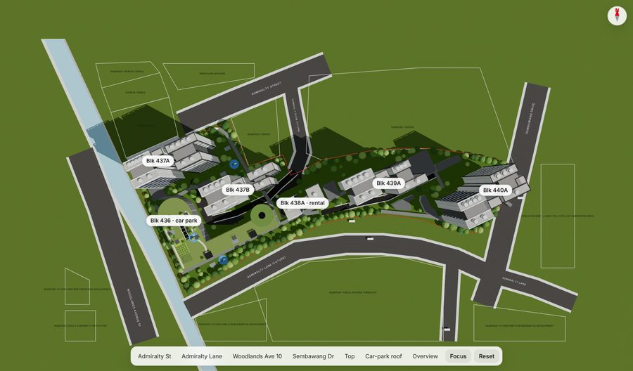
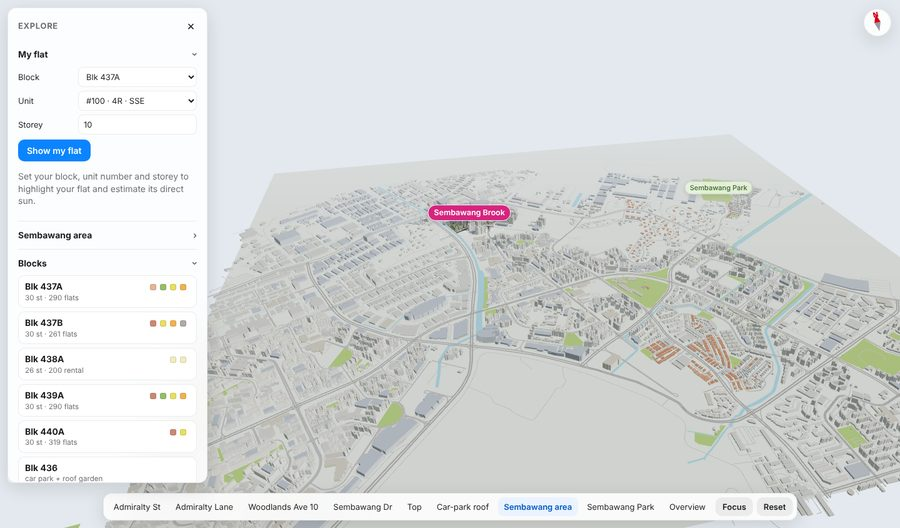
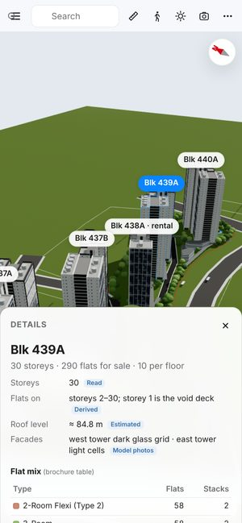

# Sembawang Brook · 3D estate model

An interactive 3D model of **Sembawang Brook**, an HDB Build-To-Order estate (2026) along Admiralty Street in Sembawang, Singapore. It is reconstructed from the brochure site plan and photos of HDB's 1:300 sales model. The whole app is one `index.html` built on [Three.js](https://threejs.org) r160, with no build step to use it. It works on desktop and phones.

**Live:** https://jardani1x.github.io/sembawang-brooks/ (once GitHub Pages is enabled; see [Deploy](#deploy))


> **Unofficial.** This is a personal project and is not affiliated with HDB.
> - HDB owns the copyright in the Sembawang Brook design and its sales materials. No brochure or sales-model images are included in this repository.
> - The brochure says that developments and facilities are subject to change.
> - This is a reconstruction, not a survey. Treat every number as an estimate unless the [Accuracy](#accuracy) table says otherwise.

## Contents
- [What's in the model](#whats-in-the-model)
- [Sembawang area (OpenStreetMap)](#sembawang-area-openstreetmap)
- [Quick start](#quick-start)
- [User guide](#user-guide)
- [Accuracy](#accuracy)
- [How it was built](#how-it-was-built)
- [Project structure](#project-structure)
- [Develop](#develop)
- [Test](#test)
- [Deploy](#deploy)
- [Limitations](#limitations)

## What's in the model

| | |
|---|---|
| **Residential blocks** | 437A, 437B, 439A and 440A have 30 storeys of flats for sale; 438A has 26 storeys of rental flats. 1,360 flats in total, matching the brochure table. |
| **Facades** | Each block has a dark-glass-grid west tower and a white "light cells" east tower, joined by a link with the 2-Room Flexi stacks and the lift core. Every block has the 4-storey bands, frame fins, roof water tanks and a void deck. |
| **Blk 436** | An 8-storey multi-storey car park with a spiral ramp and an accessible roof garden: lawn, community-garden plots, playground, shelters, elderly fitness station and the air-well slot. |
| **Low-rise** | Precinct pavilions 437, 438 and 439, the drop-off porches, shops (440: eating house, shops, mini-mart) and an electrical sub-station (441). |
| **Site** | Admiralty Street, Admiralty Close and Admiralty Lane (future roads), Sembawang Drive, Woodlands Ave 10, the Sungei Sembawang canal, the paved car-park courtyard, covered linkways and future bus bays. |
| **Context** | The neighbouring reserved sites (church, school, Chinese temple, Acacia Home, future housing, and others) are flat, labelled plots, and no buildings are invented on them. The nearby heavy vehicle park is pinned; brochure note 9 says it may cause noise. |

<p>


</p>

## Sembawang area (OpenStreetMap)

Press **Area** (or the views **Sembawang area** / **Sembawang Park**, keys <kbd>8</kbd> and <kbd>9</kbd>) to put the estate in its real surroundings. The area runs from Woodlands and Admiralty in the west to Sembawang Park on the coast, between 1.424–1.475°N and 103.79–103.848°E. It holds about **4,000 buildings**, plus roads, canals, drains, ponds and parks, all from [OpenStreetMap](https://www.openstreetmap.org/copyright).



- **Tap any building** to see its name, address, storeys and height, with where each value came from, and a link to it on openstreetmap.org.
- **Search** covers OSM names, addresses (for example `10 Admiralty Street`), parks and roads.
- **Heights:**
  - HDB blocks and other buildings that record storeys in OSM: a 3.6 m void deck plus 2.8 m per storey for residential blocks, the same as the estate model; 3 m per storey for everything else.
  - A real `height` tag is used where present. Placeholder `height=0` tags are ignored.
  - Buildings with no height data (mostly factories, sheds and landed houses) get modest defaults. **Highlight estimated heights** tints them orange.
  - In the bundled snapshot: 1,548 buildings have OSM heights and 2,475 are estimated.
- **Sun hours for your flat** also count the surrounding OSM buildings while the area is loaded.
- **Live update (on the GitHub Pages version):** **Explore → Sembawang area → Update from OpenStreetMap** downloads the latest data from the Overpass API (about 15 MB; it can take a minute). It also fetches the coastline, which turns into sea and land. The result is cached in your browser, and **Use bundled snapshot** switches back. Inside the Claude view, outside data is blocked, so the page uses the bundled snapshot instead.
- **The bundled snapshot** (`data/area-snapshot.json`) was built from an overpass-turbo export on 17 Nov 2026. That export has no coastline, so the sea north of Sembawang Park shows as land until you do a live update.
- **Placing the estate:** the estate's block and car-park outlines were fitted to OSM's own outlines of Sembawang Brook. The median gap is **0.75 m**, and the fit puts the site origin at 1.45914°N, 103.81185°E. The same fit independently confirmed the brochure's north arrow (best rotation −0.09°) and its scale (within 0.6%). OSM buildings inside the estate boundary are replaced by the detailed model.


> Map data © [OpenStreetMap contributors](https://www.openstreetmap.org/copyright), available under the Open Database Licence (ODbL 1.0). `data/area-snapshot.json` is a derived database under the same licence.

## Quick start

- **In a browser:** open the live link, or open `index.html` directly. It needs an internet connection because Three.js loads from jsDelivr.
- **Locally over HTTP** (optional): `python3 -m http.server` in this folder, then open http://localhost:8000.

The model opens on the view from Admiralty Street on landscape screens. On portrait phones it opens on an overview looking along the estate from the car park.

## User guide

### Moving around
| Action | Mouse | Touch |
|---|---|---|
| Orbit | drag | one-finger drag |
| Pan | right-drag | two-finger drag |
| Zoom | wheel (zooms towards the cursor) | pinch |
| Face north | click the compass (red needle = north) | tap the compass |

### Camera views
Buttons along the bottom, or keys <kbd>1</kbd>–<kbd>7</kbd>:

| Key | View | |
|---|---|---|
| 1 | **Admiralty St** | from the north, matching the sales-model photo taken from that side (calibrated camera fit) |
| 2 | **Admiralty Lane** | from the south |
| 3 | **Woodlands Ave 10** | from the west, over the canal |
| 4 | **Sembawang Dr** | from the east |
| 5 | **Top** | plan view, north up |
| 6 | **Car-park roof** | the Blk 436 roof garden |
| 7 | **Overview** | isometric; on phones, along the estate |
| 8 | **Sembawang area** | the whole OSM area (turns the area on) |
| 9 | **Sembawang Park** | the park and the coast |

### Blocks, stacks and flats
- **Tap a block** to open its details:
  - storeys and flats per floor
  - the brochure flat mix
  - every stack, with its flat type and which way it faces (for example, `#120 · 5-Room · faces SSE`)
- **Tap a facade** to also pick the stack under your finger and estimate which storey you tapped.
- **Tap a stack** in the table to highlight it from the void deck to the roof.
- **Search** (<kbd>/</kbd>) works on:
  - blocks (`437B`)
  - stacks (`#120`)
  - full flat addresses (`#12-160`)
  - flat types (`4 room`, `flexi`, `3gen`, `rental`)
  - facilities (`playground`, `car park`, `preschool`)
  - roads (`Admiralty`) and the `canal`

### Flat types and storeys
- **Colour stacks by flat type** with the brochure's colours (2-Room Flexi, 3-Room, 4-Room, 5-Room, 3Gen, rental). The type chips filter to one or more types: matching stacks stay coloured and the other blocks fade.
- **Storey highlight** draws a band at one storey on every block, and shows that floor's estimated height above ground.


### My flat and sun hours
Open **Explore → My flat** and pick your block, unit and storey. Then:
- the flat is marked on its facade, with a faint line up its whole stack
- **Go to my flat** flies the camera to face it
- **Estimate sun hours** gives the hours of direct sun on the flat's main facade for the date in the sun bar, and for 20 Mar, 21 Jun, 22 Sep and 21 Dec. Each row also splits out the sun before 12:00 and after 15:00 (afternoon sun).

How the estimate works:
- The sample point is 0.9 m outside the centre of the flat's main facade, at 55% of the storey height.
- It is checked every 5 minutes from 06:00 to 20:00 Singapore time.
- A sample counts as sunny when the sun is more than 0.5° above the horizon, in front of the facade (by more than about 1°), and not blocked by any modelled building.
- It ignores trees, ledges, side windows, and anything built in future on the reserved sites.

Your flat is stored only in your own browser (`localStorage`). An **Export** file includes it, so keep that in mind before sharing one.

### Sun and shadow study
Click **Sun** to open the sun bar:
- choose a date and a time from 06:00 to 20:00 Singapore time (UTC+8, no daylight saving)
- **Play day** at ½, 1 or 3 hours per second, or **Now**
- the readout shows altitude, azimuth, sunrise, solar noon and sunset
- turn on the **Sun path** layer to draw the day's arc with hour markers


### Tools
- **Measure** (<kbd>M</kbd>): tap two points on the ground or a building. It shows the straight-line distance, the plan distance and the height difference.
- **Walk:** eye level is 1.6 m.
  - Drag to look; move with <kbd>W</kbd><kbd>A</kbd><kbd>S</kbd><kbd>D</kbd> or the arrow keys; hold <kbd>Shift</kbd> to go faster.
  - On phones, use the left joystick.
  - Buildings and the canal block your path.
- **Layers:** block labels, facility pins, roads, canal, covered linkways, trees and play areas, neighbouring sites, shadows, and the sun path.
- **Heights:** floor-to-floor (2.4–3.6 m) and void-deck (2.4–6 m) heights are editable assumptions. The whole model, the overlays and the sun hours rebuild to match.
- **Image:** saves a PNG of the 3D view. Labels aren't included.
- **⋯ menu:**
  - **Export** settings and site data as JSON.
  - **Import** a file. It is validated; a bad file is rejected and nothing changes.
  - **Reset** settings.
  - **Controls & shortcuts**, and **About** (sources and a live data check).

### Keyboard shortcuts
| Key | |
|---|---|
| <kbd>1</kbd>–<kbd>7</kbd> | camera views |
| <kbd>/</kbd> | search |
| <kbd>F</kbd> | focus the selected building |
| <kbd>M</kbd> | measure |
| <kbd>R</kbd> | reset view |
| <kbd>Esc</kbd> | leave the current tool, or clear the selection |
| <kbd>?</kbd> | controls help |

Shortcuts are ignored while you type in a field or walk.



## Accuracy

| What | Source | Confidence |
|---|---|---|
| Block positions and footprints, the 25.5° estate grid, roads, canal, linkways | Brochure site plan, scale bar 0.708 m/px (three independent measurements, within 0.2%) | Measured |
| Storeys, flat mix, unit numbers, facility labels | Brochure table and site plan; unit tags on the sales model | Read |
| Storey 1 is a void deck | Every block's flat count divides exactly by its residential floors (437A: 290 = 10 × 29; 438A: 200 = 8 × 25) | Derived |
| Facade schemes, roof tanks, roof garden | Sales-model photos | Modelled from photos |
| 2.8 m floor-to-floor, 3.6 m void deck | Consistent with the model photos (2.7–2.9 m and 3.2–4.6 m); not printed in the brochure | **Estimated** (editable) |
| Car park (~24 m) and low-rise heights | Not printed in the brochure | Estimated |
| Trees, play equipment, shelters | Placed to resemble the sales model | Representative |
| Sun position | NOAA solar-position algorithm, within 0.02° of an independent calculation | Verified |
| Where the estate is, and its north and scale | Block outlines fitted to OpenStreetMap: median gap 0.75 m, rotation −0.09°, scale within 0.6% | Verified independently |
| Surrounding buildings | OpenStreetMap; heights from tags where present, otherwise estimated (flagged) | Mapped / estimated |

## How it was built

1. **Site plan → geometry.** The scale was measured three times: from the end points of the scale bar, from a fit over all 20 bar segments, and by an independent check against a calibrated camera model of a sales-model photo. North comes from the plan's arrow. Block pads, the canal banks, linkways and the paved courtyard were segmented from the plan's colours (`data/source/`).
2. **Photos → massing and facades.** Unit tags on the model (for example `4R #104`) fix which stack sits where. The photos give each tower's facade scheme, the 4-storey band rhythm, the roof tanks and the roof-garden layout. Model faces run about 1.4 m beyond the plan's unit pads at each end, and the camera fit confirmed this.
3. **Cross-checks.** A separate reviewer re-derived the scale, the grid angle, block order and the facade rule from the photos. A second, independent QA pass tested the finished app against the sources: it found no blockers, and its findings are covered by regression tests.
4. **Data checks at build time and load time.** `tools/build_data.py` asserts that every block's stacks × residential floors reproduce the brochure mix, and the app re-checks this on load (see **About**).

## Project structure

```
index.html                 the app (generated by tools/build.py; commit it so Pages can serve it)
src/
  00_core.js               data, coordinate frames, geometry helpers, state + persistence, stack index
  10_textures.js           procedural facade textures (canvas) and materials
  20_scene.js              renderer, camera, OrbitControls, lights, layer groups, resize
  30_builders.js           blocks, car park + roof garden, low-rise, ground, roads, canal, linkways, trees, pins
  40_overlays.js           flat-type colours, storey band, my-flat marker, selection outline
  50_sun.js                NOAA sun position, sun light + path, per-flat sun hours
  60_ui.js                 panels, details, search, filters, my flat, layers, heights, sun bar, menu, keyboard
  70_tools.js              camera views + transitions, picking, measure, walk
  75_osmconv.js            OSM → area data converter (pure JS; shared by the page and tools/build_area.mjs)
  80_area.js               Sembawang area: load snapshot / cache / live Overpass, meshes, picking, search, sun occlusion
  90_main.js               validation, rebuilds, on-demand render loop, init
  style.css, template.html
data/
  site-data.json           generated dataset embedded in index.html (includes the georeference)
  area-snapshot.json       OSM area snapshot (ODbL), loaded on demand
  source/siteplan.json     measured site-plan geometry (scale, frame, pads, roads, canal, facilities, …)
  source/courtyard.json    paved areas segmented from the plan
  source/georef.json       site frame ↔ WGS84 (fit to OSM building outlines)
tools/
  build_data.py            source → data/site-data.json (with self-checks)
  build.py                 src + data → index.html
  build_area.mjs           overpass-turbo GeoJSON export → data/area-snapshot.json (same converter as the page)
  segment_courtyard.py     plan colour segmentation for paved areas (needs the plan image, not included)
  fetch_three.sh           local three.js r160 for offline tests
tests/
  run.py                   headless end-to-end suite (58 checks)
  probe.py                 ad-hoc screenshots / JS probes
docs/                      README images
```

**Coordinates.**
- **World frame:** +X east, +Z south, +Y up, in metres. The origin is the south-west outer corner of Blk 436.
- **Local frame:** buildings are stored in a local frame. *u* runs along the block rows (bearing 64.5°) and *v* runs across them (bearing 154.5°). One group with `rotation.y = 25.5°` maps local to world.

**Data model** (`data/site-data.json`, `format: "sembawang-brook-site"`, `version: 1`):
- `meta`: scale, grid angle and latitude/longitude.
- `heights` and `flatTypes`.
- `blocks`: sale blocks have `towers → rows → pads` (each pad holds its flat type, unit numbers and size), plus `link`, `core` and an optional `tip`; the rental block has `points`.
- `mscp`, `lowRise`, `commercial440` and `ess441`.
- `roads`, `canal`, `drainage`, `boundary`, `linkways`, `paved`, `facilities`, `busBays` and `reserved`.

**Rendering.**
- Block shells carry generated canvas facade textures (4 bays × 4 storeys), with merged frame and band geometry.
- Roof tanks, trees and linkway posts are instanced.
- In total that is about 51k triangles and about 210 draw calls.
- The scene renders on demand, and shadows recompute only when the sun or the layers change.
- The pixel ratio is capped and drops automatically on slow devices.

## Develop

```sh
python3 tools/build_data.py     # regenerate data/site-data.json (fails loudly if the brochure totals don't reproduce)
python3 tools/build.py          # inline src/ + data/ into index.html
```

- Edit the modules in `src/`, never `index.html` directly, then rebuild.
- To change a building's geometry, edit `data/source/siteplan.json` and its corrections in `tools/build_data.py`.

**Refresh the area snapshot** from a new export. In [overpass-turbo](https://overpass-turbo.eu), run the query that `OSM_QUERY` in `src/75_osmconv.js` builds (add `way["natural"="coastline"]` to get the sea), then **Export → GeoJSON**:
```sh
node tools/build_area.mjs export.geojson 1.430,103.795,1.475,103.845   # the export's S,W,N,E box
```

**Optional private build** that opens with a flat preselected (keep it out of the public repo):
```sh
python3 tools/build.py --preset-flat 439A,160,12 --out private.html
```

## Test

```sh
pip install playwright && python -m playwright install chromium
sh tools/fetch_three.sh         # three.js r160 into vendor/ (CDN requests are served from it)
python3 tests/run.py            # desktop + phone; CHROME=/path/to/chrome to use a system Chrome
python3 tests/run.py desktop    # or: mobile, area
OSM_EXPORT=export.geojson python3 tests/run.py area   # + converter parity and the live-update flow (Overpass mocked)
```

The suite runs headless Chrome (58 checks). It covers:
- console errors and data validation
- the sun position against independent values: 21 Jun 13:06 SGT at 68.0° due north, and the solstice noon and sunrise/sunset times
- every camera view, selection, search (including `#12-160`), flat-type filters and the storey band
- my flat and the sun-hours table
- the sun bar and playback, measure, walk, the heights editor
- export, import, and rejection of a bad import
- persistence, PNG export, and the phone layout
- the area view: snapshot load and render budget, the coastline-to-land algorithm on synthetic shapes, OSM search and tapping a building, sun hours with the surroundings, and the live update. The live update test routes the Overpass request to a fixture made from the export plus a synthetic coastline, then checks the data matches the snapshot exactly, that it is cached across reloads, and that switching back to the snapshot works.

Screenshots go to `tests/shots/`, which is gitignored. The tests run in a software renderer, so they don't measure frame rate or iOS Safari behaviour.

## Deploy

GitHub Pages serves `index.html` from the repository root:
1. Open **Settings → Pages**.
2. Set **Build and deployment → Source** to **Deploy from a branch**.
3. Choose **Branch: `main`**, folder **`/ (root)`**, then **Save**.

The site appears at `https://jardani1x.github.io/sembawang-brooks/` within a few minutes. Rebuild and commit `index.html` after every change to `src/` or `data/`.

## Limitations

- **Heights** are estimates. The brochure gives storey counts only, so roof levels are about ±1 m.
- **Slab depth** comes from the plan's unit icons (about 7.9 m per row); the corridor and air-well split between rows is modelled from the photos.
- **Labels on Blk 437A #116 and #118** follow the numbering pattern of the other blocks, because the brochure digits are illegible. The flat types are certain.
- **Blk 438A:** the brochure doesn't say which tower holds the 1-Room flats and which the 2-Room, and no rental unit numbers are printed.
- **Reserved sites** around the estate (including the church site to the north) are flat, so future buildings there could reduce views and sun.
- **Trees, play equipment and roof-garden items** are representative.
- **The area view:** about 60% of the surrounding buildings have estimated heights. The bundled snapshot has no coastline (a live update adds it). Shadows are drawn around the estate only, though the sun-hours estimate counts all loaded buildings.
- **The live update** has been tested end to end against a fixture, not against the real Overpass server, which this build environment can't reach.
- **Not tested on real phones** for frame rate or iOS Safari quirks.

**Licence:** none chosen yet, so all rights are reserved by default. Add a `LICENSE` file to change that.
