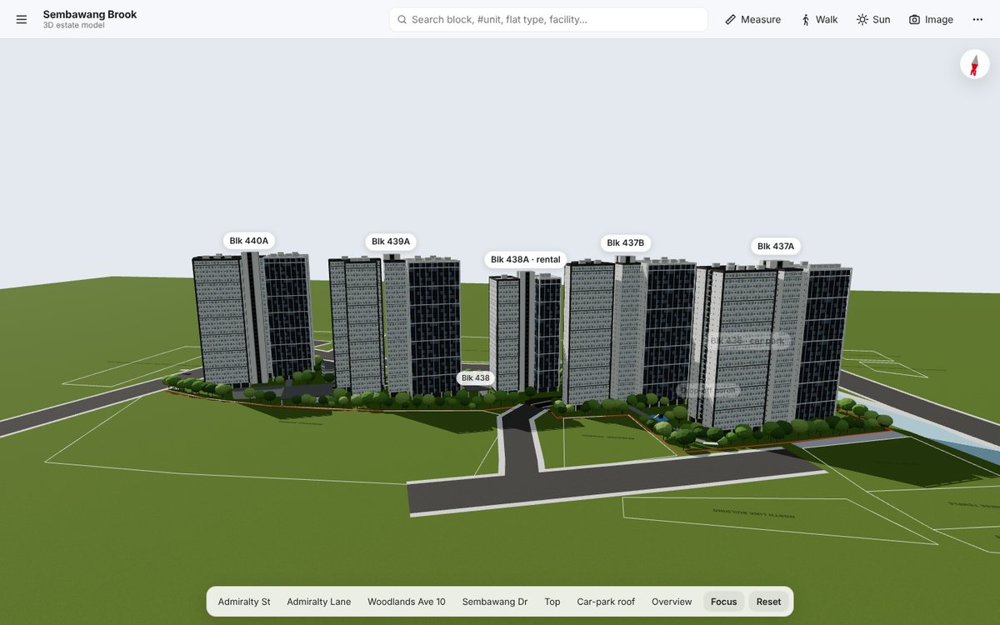
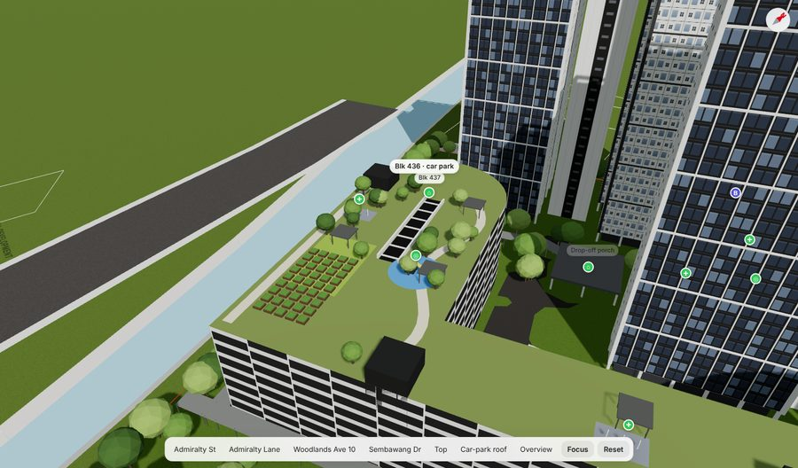
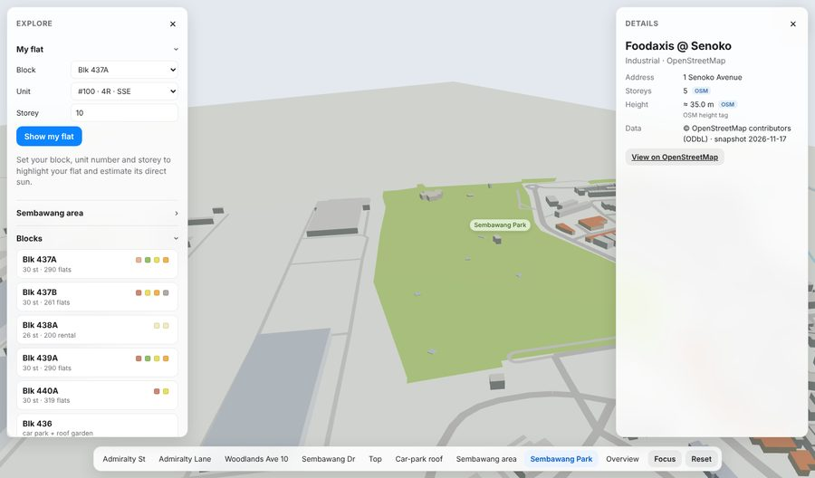
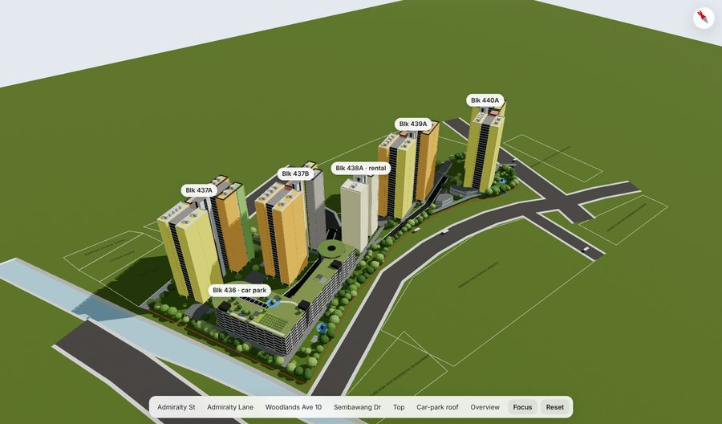
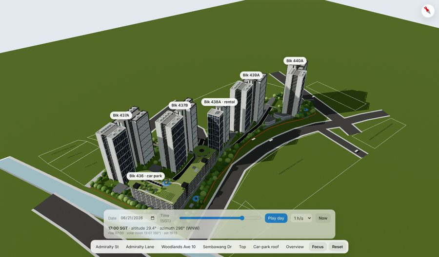
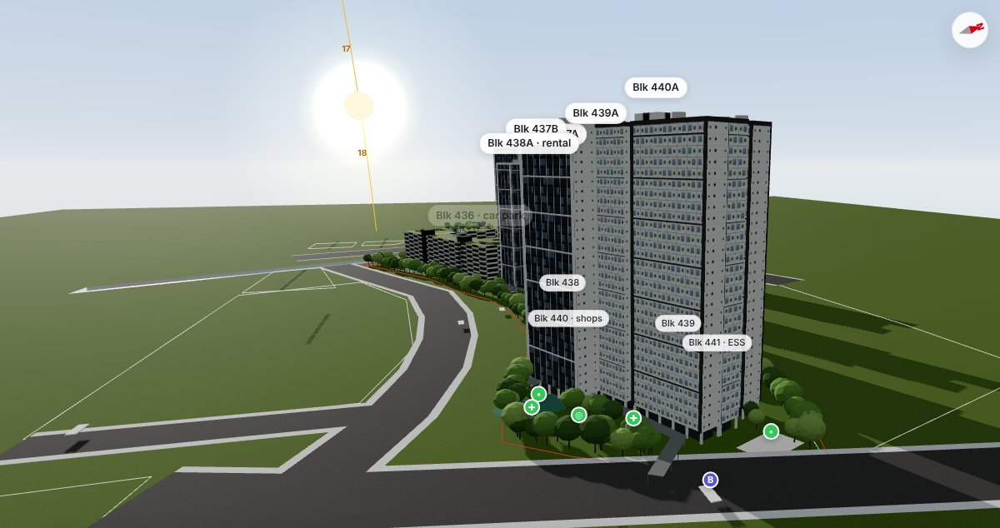
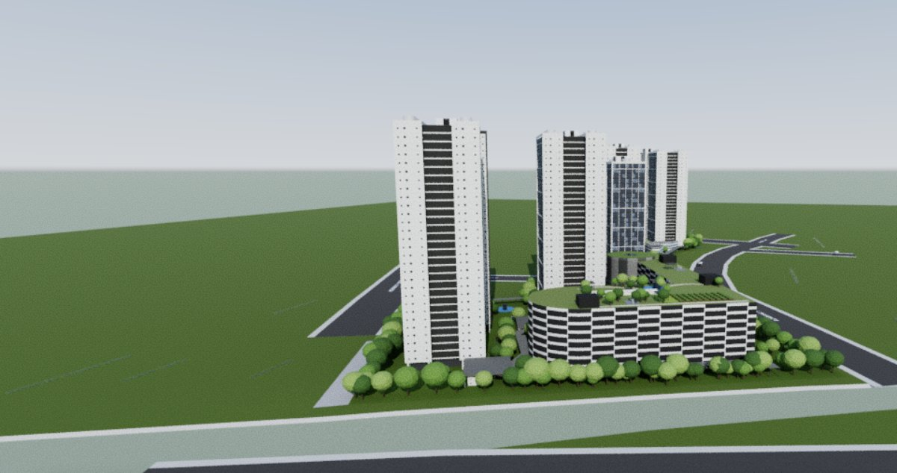

# Sembawang Brook · 3D estate model

An interactive 3D model of **Sembawang Brook**, an HDB Build-To-Order estate (2026) along Admiralty Street in Sembawang, Singapore. It is reconstructed from the brochure site plan and photos of HDB's 1:300 sales model. The whole app is one `index.html` built on [Three.js](https://threejs.org) r160, with no build step to use it. It works on desktop and phones. A second page, `singapore.html`, is a [3D map of all of Singapore](#singapore-3d-map) with OpenStreetMap buildings.

**Live:** https://jardani1x.github.io/sembawang-brooks/ (once GitHub Pages is enabled; see [Deploy](#deploy))



> **Unofficial.** This is a personal project and is not affiliated with HDB.
> - HDB owns the copyright in the Sembawang Brook design and its sales materials. No brochure or sales-model images are included in this repository.
> - The brochure says that developments and facilities are subject to change.
> - This is a reconstruction, not a survey. Treat every number as an estimate unless the [Accuracy](#accuracy) table says otherwise.

## Contents
- [What's in the model](#whats-in-the-model)
- [Sembawang area (OpenStreetMap)](#sembawang-area-openstreetmap)
- [Singapore 3D map](#singapore-3d-map)
- [Quick start](#quick-start)
- [User guide](#user-guide)
- [Accuracy](#accuracy)
- [How it was built](#how-it-was-built)
- [Project structure](#project-structure)
- [Develop](#develop)
- [Test](#test)
- [Deploy](#deploy)
- [Limitations](#limitations)

## What's in the model

| | |
|---|---|
| **Residential blocks** | 437A, 437B, 439A and 440A have 30 storeys of flats for sale; 438A has 26 storeys of rental flats. 1,360 flats in total, matching the brochure table. |
| **Facades** | Each block has a dark-glass-grid west tower and a white "light cells" east tower, joined by a link with the 2-Room Flexi stacks and the lift core. Every block has the 4-storey bands, frame fins, roof water tanks and a void deck. |
| **Blk 436** | An 8-storey multi-storey car park with a spiral ramp and an accessible roof garden: lawn, community-garden plots, playground, shelters, elderly fitness station and the air-well slot. |
| **Low-rise** | Precinct pavilions 437, 438 and 439, the drop-off porches, shops (440: eating house, shops, mini-mart) and an electrical sub-station (441). |
| **Site** | Admiralty Street, Admiralty Close and Admiralty Lane (future roads), Sembawang Drive, Woodlands Ave 10, the Sungei Sembawang canal, the paved car-park courtyard, covered linkways and future bus bays. Admiralty Close and the church and school plots beside it are traced from the plan's colours, so the road fills the band between the plot lines (about 25 m wide, widening to about 50 m at the turning loop). |
| **Context** | The neighbouring reserved sites (church, school, Chinese temple, Acacia Home, future housing, and others) are flat, labelled plots, and no buildings are invented on them. The nearby heavy vehicle park is pinned; brochure note 9 says it may cause noise. |

<p>


</p>

## Sembawang area (OpenStreetMap)

Press **Area** (or the views **Sembawang area** / **Sembawang Park**, keys <kbd>8</kbd> and <kbd>9</kbd>) to put the estate in its real surroundings. The area runs from Woodlands and Admiralty in the west to Sembawang Park on the coast, between 1.424–1.475°N and 103.79–103.848°E. It holds about **4,000 buildings**, plus roads, canals, drains, ponds and parks, all from [OpenStreetMap](https://www.openstreetmap.org/copyright).


- **Tap any building** to see its name, address, storeys and height, with where each value came from, and a link to it on openstreetmap.org.
- **Search** covers OSM names, addresses (for example `10 Admiralty Street`), parks and roads.
- **Heights:**
  - HDB blocks and other buildings that record storeys in OSM: a 3.6 m void deck plus 2.8 m per storey for residential blocks, the same as the estate model; 3 m per storey for everything else.
  - A real `height` tag is used where present. Placeholder `height=0` tags are ignored.
  - Buildings with no height data (mostly factories, sheds and landed houses) get modest defaults. **Highlight estimated heights** tints them orange.
  - In the bundled snapshot: 1,548 buildings have OSM heights and 2,475 are estimated.
- **Sun hours for your flat** also count the surrounding OSM buildings while the area is loaded.
- **Live update (on the GitHub Pages version):** **Explore → Sembawang area → Update from OpenStreetMap** downloads the latest data from the Overpass API (about 15 MB; it can take a minute). It also fetches the coastline, which turns into sea and land. The result is cached in your browser, and **Use bundled snapshot** switches back. Inside the Claude view, outside data is blocked, so the page uses the bundled snapshot instead.
- **The bundled snapshot** (`data/area-snapshot.json`) was built from two overpass-turbo exports made on 17 Nov 2026: the main one (buildings, roads, water, parks) and a coastline-only one. So the Straits of Johor show as sea, with the shoreline and the old naval-base basins as OSM maps them.
- **Placing the estate:** the estate's block and car-park outlines were fitted to OSM's own outlines of Sembawang Brook. The median gap is **0.75 m**, and the fit puts the site origin at 1.45914°N, 103.81185°E. The same fit independently confirmed the brochure's north arrow (best rotation −0.09°) and its scale (within 0.6%). OSM buildings inside the estate boundary are replaced by the detailed model.



> Map data © [OpenStreetMap contributors](https://www.openstreetmap.org/copyright), available under the Open Database Licence (ODbL 1.0). `data/area-snapshot.json` is a derived database under the same licence.

## Singapore 3D map

The **Estate | Singapore** switch in the header (on a phone: **⋯ → Singapore 3D map**) opens `singapore.html`. It is a 3D map of the whole island in which every building OpenStreetMap knows about is extruded to its height. It is built on [MapLibre GL JS](https://maplibre.org) 5.24.1 with vector tiles from [OpenFreeMap](https://openfreemap.org), and it streams those tiles while you move, so it needs an internet connection.

- **First visit** opens over Sembawang Brook. The estate is outlined in pink with a pin, and the pin's popup links back to the estate model. After that, the page reopens where you left it, and the address bar keeps the view (`#view=zoom/lat/lon/bearing/pitch`), so a link shows the same view (except while it follows your location; see below).
- **Moving around:** drag to pan; right-drag or Ctrl-drag (two fingers on a phone) to rotate and tilt; scroll or pinch to zoom. The buttons at top right zoom, and the compass resets north and tilt.
- **Buildings** appear from zoom 13 (the tiles carry no buildings below that), rising to full height by zoom 14. Their colour deepens with height. A hint asks you to zoom in when you are too far out.
- **Places** lists 19 places to fly to: the estate, the island overview, Sembawang Park, nearby MRT stations, town centres, the CBD, Marina Bay, Pinnacle@Duxton, Sentosa and Changi. **Search** filters that list as you type. **Search OpenStreetMap for "…"** then looks up any address, street or building in Singapore with [Nominatim](https://nominatim.org). It runs only when you ask, at most once a second, and remembers answers, as Nominatim's usage policy requires.
- **My location** (the ◎ button under the zoom buttons, or <kbd>L</kbd>): the browser asks for permission, then the map flies to you and follows you. Your position is a blue dot (with a pale circle showing the GPS accuracy) under a **3D Starship and Super Heavy** model, drawn at its real height of 124 m, so you can compare it with the HDB blocks around you. Buildings in front of it hide it. Zoomed far out it is drawn bigger so it stays visible, and the status line says by how much (for example "rocket ×6.9 size"). It is lit by the same sun as the map. While you are still it stands on the spot; while you move it hovers 30 m up, leans 20° towards where you are going and fires its engines, and when you stop it lands. The direction comes from the phone's compass heading when it reports one, else from the direction between position updates. The model (1.2 MB) and three.js load only the first time you switch location on. If they can't load, a flat cartoon rocket stands in. Drag the map or pick a place and following pauses (the button then re-centres); tap it while following to stop. Outside Singapore it tells you so and leaves the map where it is. **Your position stays on your device:** it is not sent anywhere, and while the map follows you it is kept out of the `#view` link and the saved view.
- **Sun:** pick a date and a Singapore time, or press ▶ to run through the day (one hour per second). Buildings are lit from the sun's true direction for that moment, using the same NOAA sun maths as the estate model (`src/01_suncalc.js`). The light warms at sunrise and sunset, and the sky and haze change colour with the sun's height. The readout's tooltip gives sunrise, solar noon and sunset.

> Map © [OpenStreetMap contributors](https://www.openstreetmap.org/copyright) (ODbL), tiles by [OpenFreeMap](https://openfreemap.org) in the [OpenMapTiles](https://openmaptiles.org) schema; the attribution is shown on the map.
>
> Rocket model: ["SpaceX Starship Block 3"](https://sketchfab.com/3d-models/spacex-starship-block-3-6f6c6f88a3eb4b4d822fdca66733fbb2) by [Clarence365](https://sketchfab.com/clarence365), licensed [CC BY 4.0](https://creativecommons.org/licenses/by/4.0/). Changes: the logo decal was removed, and the meshes were merged and simplified from 913k to 124k triangles (8.0 MB → 1.2 MB) with `tools/slim_rocket.mjs`. `assets/starship-block3.glb` is shared under the same licence. The model is a fan-made depiction; SpaceX, Starship and Super Heavy are SpaceX's names, and this project is not affiliated with or endorsed by SpaceX.

## Quick start

- **In a browser:** open the live link, or open `index.html` directly. It needs an internet connection because Three.js loads from jsDelivr.
- **Locally over HTTP** (optional): `python3 -m http.server` in this folder, then open http://localhost:8000.

The model opens on the view from Admiralty Street on landscape screens. On portrait phones it opens on an overview looking along the estate from the car park.

## User guide

### Moving around
| Action | Mouse | Touch |
|---|---|---|
| Move the map | drag | one-finger drag |
| Rotate and tilt | right-drag, or <kbd>Ctrl</kbd>/<kbd>⌘</kbd>/<kbd>Shift</kbd> + drag | two-finger drag |
| Zoom | wheel (zooms towards the cursor) | pinch |
| Face north | click the compass (red needle = north) | tap the compass |

Dragging moves the map, like an online map. If you prefer dragging to rotate the view, choose **⋯ → Drag rotates the view**; the setting is remembered. You can pan about 900 m around the estate, or across the whole map in the area view.

### Camera views
Buttons along the bottom, or keys <kbd>1</kbd>–<kbd>7</kbd>:

| Key | View | |
|---|---|---|
| 1 | **Admiralty St** | from the north, matching the sales-model photo taken from that side (calibrated camera fit) |
| 2 | **Admiralty Lane** | from the south |
| 3 | **Woodlands Ave 10** | from the west, over the canal |
| 4 | **Sembawang Dr** | from the east |
| 5 | **Top** | plan view, north up |
| 6 | **Car-park roof** | the Blk 436 roof garden |
| 7 | **Overview** | isometric; on phones, along the estate |
| 8 | **Sembawang area** | the whole OSM area (turns the area on) |
| 9 | **Sembawang Park** | the park and the coast |

### Blocks, stacks and flats
- **Tap a block** to open its details:
  - storeys and flats per floor
  - the brochure flat mix
  - every stack, with its flat type and which way it faces (for example, `#120 · 5-Room · faces SSE`)
- **Tap a facade** to also pick the stack under your finger and estimate which storey you tapped.
- **Tap a stack** in the table to highlight it from the void deck to the roof.
- **Search** (<kbd>/</kbd>) works on:
  - blocks (`437B`)
  - stacks (`#120`)
  - full flat addresses (`#12-160`)
  - flat types (`4 room`, `flexi`, `3gen`, `rental`)
  - facilities (`playground`, `car park`, `preschool`)
  - roads (`Admiralty`) and the `canal`

### Flat types and storeys
- **Colour stacks by flat type** with the brochure's colours (2-Room Flexi, 3-Room, 4-Room, 5-Room, 3Gen, rental). The type chips filter to one or more types: matching stacks stay coloured and the other blocks fade.
- **Storey highlight** draws a band at one storey on every block, and shows that floor's estimated height above ground.



### My flat and sun hours
Open **Explore → My flat** and pick your block, unit and storey. Then:
- the flat is marked on its facade, with a faint line up its whole stack
- **Go to my flat** flies the camera to face it
- **Estimate sun hours** gives the hours of direct sun on the flat's main facade for the date in the sun bar, and for 20 Mar, 21 Jun, 22 Sep and 21 Dec. Each row also splits out the sun before 12:00 and after 15:00 (afternoon sun).

How the estimate works:
- The sample point is 0.9 m outside the centre of the flat's main facade, at 55% of the storey height.
- It is checked every 5 minutes from 06:00 to 20:00 Singapore time.
- A sample counts as sunny when the sun is more than 0.5° above the horizon, in front of the facade (by more than about 1°), and not blocked by any modelled building.
- It ignores trees, ledges, side windows, and anything built in future on the reserved sites.

Your flat is stored only in your own browser (`localStorage`). An **Export** file includes it, so keep that in mind before sharing one.

### Sun and shadow study
Click **Sun** to open the sun bar:
- choose a date and a time from 06:00 to 20:00 Singapore time (UTC+8, no daylight saving)
- **Play day** at ½, 1 or 3 hours per second, or **Now**
- the readout shows altitude, azimuth, sunrise, solar noon and sunset
- watch the **3D sun** move across the sky above the model: it glows white by day and turns orange near sunrise and sunset. The sky follows the time of day: blue overhead, warm towards the sun at dusk and dawn, dark at night. The fog takes the horizon colour. Turn it off with the **Sun & sky** layer
- turn on the **Sun path** layer to draw the day's arc with hour markers; the 3D sun rides on it

The sun is about 150 million km away, so at any moment it sits in the same direction for every building in Sembawang and its rays arrive parallel. The sun path is therefore drawn as a dome: over the estate in the estate view, and over whatever part of the map you are looking at in the area view. Only its size and centre change; the directions and times on it are the same. Near the equator (1.46° N) the arc is tall. The sun rises in the east, passes almost overhead at noon (about 25° off the zenith to the south in December, 22° to the north in June) and sets in the west. The 3D sun is drawn on that same dome, so it sits on the arc. Buildings in front of it hide it, and its direction from the dome's centre is exactly the sun's. In the estate views the camera looks down, so the sun is often above the top of the screen; zoom out, tilt up or use the area view to see it.

Shadows work the same way. In the estate view they cover about 660 m around the estate, at full sharpness. In the area view they follow the view, so every surrounding building casts one, and zoomed out they cover the whole map at coarser resolution.





### Photo-real render
**Render** traces the current view with real light paths: direct sun, light from the whole sky, light bounced off walls and the ground, and soft contact shadows. It uses the same sun as the live view (date, time, direction and strength), under a Singapore clear sky that is hazy blue overhead and paler at the horizon, brighter around the sun.
- The image starts grainy and sharpens as samples add up: 400 samples on a computer, 160 on a phone. Most views look clean after 10–60 seconds on a laptop GPU; phones are slower.
- Moving the camera, or changing the date or time in **Sun**, restarts it. Changing layers, the area view or your flat rebuilds the scene first.
- **Save image** (or **Image**) saves the rendered PNG; **Stop** returns to the live view. Labels and outlines are not in the render, and you can't select blocks while it runs.
- The first time, the page downloads the ray tracer, [three-gpu-pathtracer](https://github.com/gkjohnson/three-gpu-pathtracer) 0.0.23 with three-mesh-bvh 0.7.8 (about 0.4 MB), and compiles it. That takes a few seconds on most GPUs. It needs WebGL 2 with float render targets, which nearly all current browsers have.



### Tools
- **Measure** (<kbd>M</kbd>): tap two points on the ground or a building. It shows the straight-line distance, the plan distance and the height difference.
- **Walk:** eye level is 1.6 m.
  - Drag to look; move with <kbd>W</kbd><kbd>A</kbd><kbd>S</kbd><kbd>D</kbd> or the arrow keys; hold <kbd>Shift</kbd> to go faster.
  - On phones, use the left joystick.
  - Buildings and the canal block your path.
- **Layers:** block labels, facility pins, roads, canal, covered linkways, trees and play areas, neighbouring sites, shadows, and the sun path.
- **Heights:** floor-to-floor (2.4–3.6 m) and void-deck (2.4–6 m) heights are editable assumptions. The whole model, the overlays and the sun hours rebuild to match.
- **Image:** saves a PNG of the 3D view (the ray-traced image while **Render** is on). Labels aren't included.
- **⋯ menu:**
  - **Export** settings and site data as JSON.
  - **Import** a file. It is validated; a bad file is rejected and nothing changes.
  - **Reset** settings.
  - **Controls & shortcuts**, and **About** (sources and a live data check).

### Keyboard shortcuts
| Key | |
|---|---|
| <kbd>1</kbd>–<kbd>7</kbd> | camera views |
| <kbd>/</kbd> | search |
| <kbd>F</kbd> | focus the selected building |
| <kbd>M</kbd> | measure |
| <kbd>R</kbd> | reset view |
| <kbd>Esc</kbd> | leave the current tool, or clear the selection |
| <kbd>?</kbd> | controls help |

Shortcuts are ignored while you type in a field or walk.


## Accuracy

| What | Source | Confidence |
|---|---|---|
| Block positions and footprints, the 25.5° estate grid, roads, canal, linkways | Brochure site plan, scale bar 0.708 m/px (three independent measurements, within 0.2%) | Measured |
| Storeys, flat mix, unit numbers, facility labels | Brochure table and site plan; unit tags on the sales model | Read |
| Storey 1 is a void deck | Every block's flat count divides exactly by its residential floors (437A: 290 = 10 × 29; 438A: 200 = 8 × 25) | Derived |
| Facade schemes, roof tanks, roof garden | Sales-model photos | Modelled from photos |
| 2.8 m floor-to-floor, 3.6 m void deck | Consistent with the model photos (2.7–2.9 m and 3.2–4.6 m); not printed in the brochure | **Estimated** (editable) |
| Car park (~24 m) and low-rise heights | Not printed in the brochure | Estimated |
| Trees, play equipment, shelters | Placed to resemble the sales model | Representative |
| Sun position | NOAA solar-position algorithm, within 0.02° of an independent calculation | Verified |
| Where the estate is, and its north and scale | Block outlines fitted to OpenStreetMap: median gap 0.75 m, rotation −0.09°, scale within 0.6% | Verified independently |
| Surrounding buildings | OpenStreetMap; heights from tags where present, otherwise estimated (flagged) | Mapped / estimated |

## How it was built

1. **Site plan → geometry.** The scale was measured three times: from the end points of the scale bar, from a fit over all 20 bar segments, and by an independent check against a calibrated camera model of a sales-model photo. North comes from the plan's arrow. Block pads, the canal banks, linkways and the paved courtyard were segmented from the plan's colours (`data/source/`).
2. **Photos → massing and facades.** Unit tags on the model (for example `4R #104`) fix which stack sits where. The photos give each tower's facade scheme, the 4-storey band rhythm, the roof tanks and the roof-garden layout. Model faces run about 1.4 m beyond the plan's unit pads at each end, and the camera fit confirmed this.
3. **Cross-checks.** A separate reviewer re-derived the scale, the grid angle, block order and the facade rule from the photos. A second, independent QA pass tested the finished app against the sources: it found no blockers, and its findings are covered by regression tests.
4. **Data checks at build time and load time.** `tools/build_data.py` asserts that every block's stacks × residential floors reproduce the brochure mix, and the app re-checks this on load (see **About**).

## Project structure

```
index.html                 the app (generated by tools/build.py; commit it so Pages can serve it)
assets/starship-block3.glb 3D location pin for the Singapore map (CC BY 4.0, see credits above)
singapore.html             the Singapore 3D map (also generated by tools/build.py; commit it too)
src/
  00_core.js               data, coordinate frames, geometry helpers, state + persistence, stack index
  01_suncalc.js            NOAA sun position, sunrise/sunset, sky colours by sun height (shared by both pages)
  10_textures.js           procedural facade textures (canvas) and materials
  20_scene.js              renderer, camera, OrbitControls, lights, layer groups, resize
  30_builders.js           blocks, car park + roof garden, low-rise, ground, roads, canal, linkways, trees, pins
  40_overlays.js           flat-type colours, storey band, my-flat marker, selection outline
  50_sun.js                NOAA sun position, sun light + path, per-flat sun hours
  55_sky.js                3D sun on the sun-path dome + time-of-day sky dome and fog colour
  60_ui.js                 panels, details, search, filters, my flat, layers, heights, sun bar, menu, keyboard
  70_tools.js              camera views + transitions, picking, measure, walk
  75_osmconv.js            OSM → area data converter (pure JS; shared by the page and tools/build_area.mjs)
  80_area.js               Sembawang area: load snapshot / cache / live Overpass, meshes, picking, search, sun occlusion
  85_render.js             photo-real render: lazy-loads the path tracer, builds the traced scene, sky + sun, sampling, save
  90_main.js               validation, rebuilds, on-demand render loop, init
  style.css, template.html
  sg/main.js               Singapore map: MapLibre setup, 3D building layer, estate outline + pin, places, search, sun light + sky
  sg/style.css, sg/template.html
data/
  site-data.json           generated dataset embedded in index.html (includes the georeference)
  area-snapshot.json       OSM area snapshot (ODbL), loaded on demand
  source/siteplan.json     measured site-plan geometry (scale, frame, pads, roads, canal, facilities, …)
  source/courtyard.json    paved areas segmented from the plan
  source/georef.json       site frame ↔ WGS84 (fit to OSM building outlines)
tools/
  build_data.py            source → data/site-data.json (with self-checks)
  build.py                 src + data → index.html
  build_area.mjs           overpass-turbo GeoJSON export → data/area-snapshot.json (same converter as the page)
  segment_courtyard.py     plan colour segmentation for paved areas (needs the plan image, not included)
  slim_rocket.mjs          simplifies the downloaded rocket model into assets/ (glTF-Transform + meshoptimizer)
  make_sg_tiles.mjs        offline vector-tile fixture for the Singapore map tests (from the area snapshot)
  fetch_three.sh           local three.js r160, the path tracer, MapLibre and the tile tools for offline tests
tests/
  run.py                   headless end-to-end suite
  probe.py                 ad-hoc screenshots / JS probes
docs/                      README images
```

**Coordinates.**
- **World frame:** +X east, +Z south, +Y up, in metres. The origin is the south-west outer corner of Blk 436.
- **Local frame:** buildings are stored in a local frame. *u* runs along the block rows (bearing 64.5°) and *v* runs across them (bearing 154.5°). One group with `rotation.y = 25.5°` maps local to world.

**Data model** (`data/site-data.json`, `format: "sembawang-brook-site"`, `version: 1`):
- `meta`: scale, grid angle and latitude/longitude.
- `heights` and `flatTypes`.
- `blocks`: sale blocks have `towers → rows → pads` (each pad holds its flat type, unit numbers and size), plus `link`, `core` and an optional `tip`; the rental block has `points`.
- `mscp`, `lowRise`, `commercial440` and `ess441`.
- `roads`, `canal`, `drainage`, `boundary`, `linkways`, `paved`, `facilities`, `busBays` and `reserved`.

**Rendering.**
- Block shells carry generated canvas facade textures (4 bays × 4 storeys), with merged frame and band geometry.
- Roof tanks, trees and linkway posts are instanced.
- In total that is about 51k triangles and about 210 draw calls.
- The scene renders on demand, and shadows recompute only when the sun or the layers change.
- The pixel ratio is capped and drops automatically on slow devices.

## Develop

```sh
python3 tools/build_data.py     # regenerate data/site-data.json (fails loudly if the brochure totals don't reproduce)
python3 tools/build.py          # inline src/ + data/ into index.html, and build singapore.html next to it
```

- Edit the modules in `src/`, never `index.html` directly, then rebuild.
- To change a building's geometry, edit `data/source/siteplan.json` and its corrections in `tools/build_data.py`.

**Refresh the area snapshot** from new exports. In [overpass-turbo](https://overpass-turbo.eu), run the query that `OSM_QUERY` in `src/75_osmconv.js` builds and **Export → GeoJSON**. If the export has no coastline, export it separately with `[out:json][timeout:60];way["natural"="coastline"](1.424,103.79,1.475,103.848);out geom;`. Then merge them (a feature in both is kept once):
```sh
node tools/build_area.mjs export.geojson coastline.geojson 1.430,103.795,1.475,103.845   # last arg: the main export's S,W,N,E box
```

**Optional private build** that opens with a flat preselected (keep it out of the public repo):
```sh
python3 tools/build.py --preset-flat 439A,160,12 --out private.html \
    --sg-url https://jardani1x.github.io/sembawang-brooks/singapore.html
```
`--sg-url` points the Singapore tab somewhere else. An absolute URL opens in a new tab and builds no Singapore page, which suits hosts that block outside map tiles.

## Test

```sh
pip install playwright && python -m playwright install chromium
sh tools/fetch_three.sh         # three.js r160, the path tracer, MapLibre and the tile tools into vendor/ (CDN requests are served from it)
python3 tests/run.py            # every section; CHROME=/path/to/chrome to use a system Chrome
python3 tests/run.py desktop    # or: mobile, area, render, sg
OSM_EXPORT=export.geojson python3 tests/run.py area   # + converter parity and the live-update flow (Overpass mocked)
```

The suite runs headless Chrome (142 checks). It covers:
- console errors and data validation
- the sun position against independent values: 21 Jun 13:06 SGT at 68.0° due north, and the solstice noon and sunrise/sunset times
- every camera view, selection, search (including `#12-160`), flat-type filters and the storey band
- my flat and the sun-hours table
- the sun bar and playback, measure, walk, the heights editor
- export, import, and rejection of a bad import
- persistence, PNG export, the phone layout, and that the view stops redrawing once it is still
- moving around: drag pans with no rotation and selects nothing; right-drag and Ctrl-drag rotate in place; a drag that starts on a label still pans while a tap on a label still selects it; panning stops at the model's edge; the drag-rotates option and its saving; and a real one-finger touch drag on the phone
- the 3D sun: its true direction for the date and time, that it lies on the sun-path arc and is drawn bright at that spot, a neutral sky at noon, warm at sunset and dark at night with the fog matching, and the layer switch
- the area view: snapshot load and render budget; land and sea in the right places (the estate and Sembawang Park on land, two points in the Straits at sea); the coastline-to-land algorithm on synthetic shapes; OSM search and tapping a building; sun hours with the surroundings; the sunlight frame (whole map in the overview, back to the estate when the area is off); a pixel test that buildings 1.6–2.1 km from the estate cast shadows; and the live update.
- The live update test routes the Overpass request to a fixture built from the exports (`OSM_EXPORT=export.geojson:coastline.geojson`). It uses the real coastline, or a synthetic one if none is given. It then checks that the data matches the snapshot exactly, that land and sea are right in the live query box (Singapore plus a sliver of the Johor shore), that it is cached across reloads, and that switching back to the snapshot works.

- the Singapore map (`sg`), fully offline: the style and tiles from tiles.openfreemap.org are served from a fixture. `tools/make_sg_tiles.mjs` turns the area snapshot into OpenMapTiles-shaped vector tiles, with a few `hide_3d` parts, into `tests/fixtures/`, and the test uses a cut-down Liberty-shaped style. Nominatim is mocked. The checks cover:
  - the 3D layer replacing the style's own and sitting under the labels; the estate outline under the buildings; the first view and the `#view` hash
  - extruded buildings in view with `hide_3d` parts left out, and a pixel test that they change the picture
  - the light matching the sun position, and a pixel test of its direction: a white test tower's west wall is dark at 09:00 and lit at 16:30, while its south wall barely changes
  - the date, time and play controls; a darker sky and warm light at dusk
  - search: no lookups while typing, keyboard selection, the Nominatim request limited to Singapore, caching, 1-second spacing and error text
  - the places panel and island overview (zoom hint, no buildings below zoom 13); the pin popup, tab links and attribution; the reopened view
  - a clear message when the style can't be loaded; the phone layout and a real one-finger touch pan
  - my location, with emulated GPS positions: off until asked; flying to you and following; the accuracy circle's radius; the rocket drawn over the dot (pixels); a 60 m walk north-east turning the rocket to 45°; your position kept out of the link and saved settings; a drag pausing follow while the pin keeps moving; re-centring; outside Singapore; stopping; the <kbd>L</kbd> key; a refused permission; and the phone button
  - the 3D rocket: it loads on demand and replaces the flat one, with the maker credited; its height in pixels matches a 124 m MapLibre extrusion beside it to within 1 px and its base sits on your position; it is darker at night; it is drawn bigger when zoomed out; while moving it hovers, leans towards the heading and its flame shows (pixels); it disappears when tracking stops; and the flat rocket stays if the model can't load
- the photo-real render: the path tracer loads and accumulates samples. Its shadows are checked against a third method, CPU rays cast from grass points towards the sun, and the live shadow map is checked the same way. The test also confirms that looking at a low sun puts the sky's glow on the sun, that vertex colours reach the tracer intact (tree crowns come out green), that pressing Stop while it loads cancels it, that taps don't select, that hiding trees rebuilds the scene, that moving the camera restarts the image, that Save downloads the PNG, and that Stop restores the live view.

Screenshots go to `tests/shots/`, which is gitignored. The tests run in a software renderer, so they don't measure frame rate or iOS Safari behaviour.

## Deploy

GitHub Pages serves `index.html` from the repository root:
1. Open **Settings → Pages**.
2. Set **Build and deployment → Source** to **Deploy from a branch**.
3. Choose **Branch: `main`**, folder **`/ (root)`**, then **Save**.

The site appears at `https://jardani1x.github.io/sembawang-brooks/` within a few minutes, with the Singapore map at `…/singapore.html`. Rebuild and commit `index.html` and `singapore.html` after every change to `src/` or `data/`.

## Limitations

- **Heights** are estimates. The brochure gives storey counts only, so roof levels are about ±1 m.
- **Slab depth** comes from the plan's unit icons (about 7.9 m per row); the corridor and air-well split between rows is modelled from the photos.
- **Labels on Blk 437A #116 and #118** follow the numbering pattern of the other blocks, because the brochure digits are illegible. The flat types are certain.
- **Blk 438A:** the brochure doesn't say which tower holds the 1-Room flats and which the 2-Room, and no rental unit numbers are printed.
- **Reserved sites** around the estate (including the church site to the north) are flat, so future buildings there could reduce views and sun.
- **Trees, play equipment and roof-garden items** are representative.
- **The area view:** about 60% of the surrounding buildings have estimated heights. The ground runs under every building that straddles the query box. Zoomed out, area shadows are coarse (about 2 m per shadow-map pixel on a computer, 4 m on a phone).
- **The live update** has been tested end to end against a fixture, not against the real Overpass server, which this build environment can't reach.
- **The photo-real render** has been tested only in a software renderer here, at low resolution and with a few samples. Speed on real GPUs and phones is untested. It uses an older release of the path tracer (0.0.23, from 2024), because newer ones need three.js r185+. Two Scene fields that release reads (added in r162) get default values at load time. There is no haze, so distant ground meets the sky at a clean horizon.
- **The Singapore map** has been tested only offline, against fixture tiles of Sembawang and a cut-down style; the build environment can't reach OpenFreeMap or Nominatim. Building heights are whatever OpenStreetMap records; untagged buildings get the tile's default height. It lights buildings from the sun but casts no shadows (MapLibre can't), and the base map stays in daylight colours at night. The fly-to points in **Places** are approximate centres. The 3D rocket was tested only in a software renderer, so how smoothly it draws on phones is untested. **My location** was tested with emulated positions only: real GPS accuracy, compass headings and battery use on phones are untested. It needs https (GitHub Pages is), and stops when the page is closed or the phone locks the browser.
- **Not tested on real phones** for frame rate or iOS Safari quirks.

**Licence:** none chosen yet, so all rights are reserved by default. Add a `LICENSE` file to change that.
